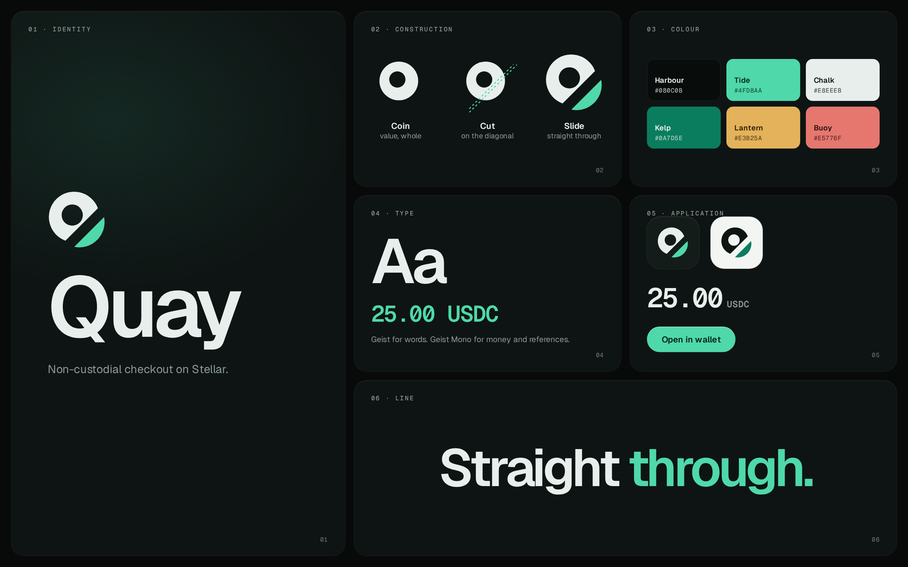

# Quay brand guide

## The idea

Quay is where value lands and moves on. A quay never owns the cargo; it is only
the place the cargo comes ashore. That is the product: a buyer's payment lands
in the seller's own wallet, and Quay never holds it. The brand line is
**Straight through.**

## The mark

A coin, cut on the diagonal, with the cut slice slid out to the lower right.

- Read as a letter, it is a **Q**, and the slid slice is its tail.
- Read as an object, it is **value passing straight through**: whole, then cut,
  then moving on, never held.

Construction (all on a 32 unit square, centre 15,15):

| Step | Value |
| --- | --- |
| Coin | radius 10.5, with a 4.4 radius counter set 0.8 up and left of centre |
| Cut | a 45 degree line 4.4 from centre toward the lower right, with a 1.4 gap |
| Slide | the lower-right slice moves 3.0 along the same diagonal |

The body takes the foreground colour. The slice always takes the one accent
(Tide on dark, Kelp on light). The geometry is stored as plain paths with no ids,
in `apps/web/app/components/Logo.tsx` and `apps/web/public/brand/*.svg`.

### Files

| File | Use |
| --- | --- |
| `apps/web/public/brand/quay-mark-on-dark.svg` | mark for dark surfaces |
| `apps/web/public/brand/quay-mark-on-light.svg` | mark for light surfaces |
| `apps/web/public/brand/quay-mark-mono.svg` | one-colour print, stamps, embossing |
| `apps/web/app/icon.svg`, `apple-icon.png` | favicon and home-screen icon |
| `apps/web/app/opengraph-image.png` | social share card (1200 x 630) |
| `docs/brand/quay-lockup-on-dark.png`, `-on-light.png` | transparent lockups for decks and READMEs |

### Rules

- **Clear space:** keep at least the width of the counter (about 8.8 units, or a
  quarter of the mark's width) clear on every side.
- **Minimum size:** 16 px for the mark alone, 80 px wide for the lockup.
- **Do not** recolour the slice, rotate the mark, close the gap, outline it, put
  it on a busy image, or use the mark and a competitor's mark side by side.

## Colour

| Name | Hex | Role |
| --- | --- | --- |
| Harbour | `#080C0B` | dark background |
| Tide | `#4FD8AA` | the accent on dark: primary action, settled |
| Chalk | `#E8EEEB` | text on dark |
| Paper | `#F3F5F2` | light background |
| Kelp | `#0A7D5E` | the accent on light (passes text contrast on Paper) |
| Lantern | `#E3B25A` | status only: pending, underpaid |
| Buoy | `#E5776F` | status only: error, failed |

One accent per surface. Lantern and Buoy carry status and are never decoration.
Tokens live in `apps/web/app/globals.css`.

## Type

Geist for words, Geist Mono for money, references and hashes. Amounts are always
mono and tabular. Headlines are tight (letter-spacing about -0.05em) and set in
sentence case. Font files are local (`apps/web/app/fonts`, SIL OFL 1.1).

## Voice

Plain, specific and honest.

- Sentence case. No exclamation marks. No "seamless", "unleash" or "next-gen".
- Say what is true today. Cash-out is not live on mainnet, so copy does not
  imply it is. The landing page's status section is the model.
- Name the thing: "payment link", "checkout", "cash out", not "solution".
